# DocuShelf

**A document archive in which an ordinary folder tree is the single source of truth.**

DocuShelf accepts documents from many sources – browser upload, scanners via SMB, FTP or
scan-to-mail, a mailbox, your phone's share menu – recognises the text (OCR), suggests where to
file each document and files it after your confirmation, or automatically if you switch that on.
Everything is searchable. Switch DocuShelf off and a clean, readable folder tree of PDF files
remains.

Made for households and families, not as an enterprise DMS. An alternative to Paperless-ngx for
everyone who thinks in folders. The user interface is German.

## Screenshots

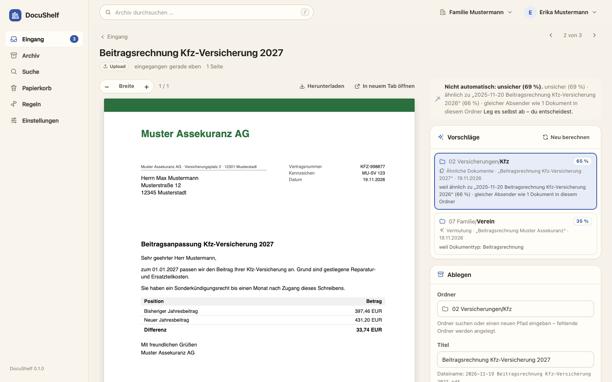

| | |
|---|---|
| 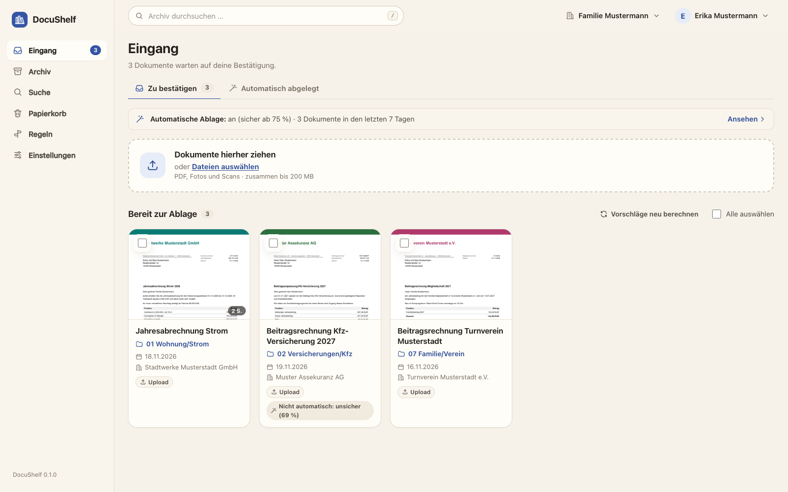 | 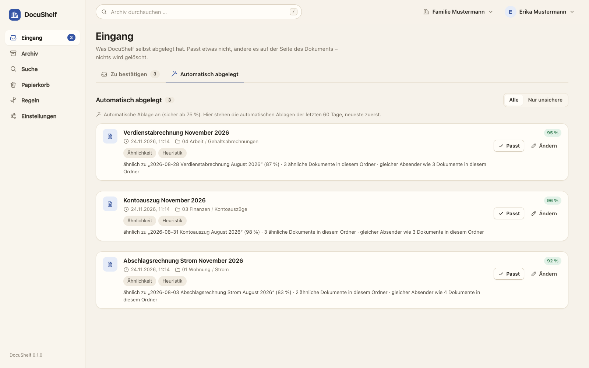 |
| Inbox: documents waiting with a suggested folder | Automatic filings with confidence, reasons and "Passt" |
| 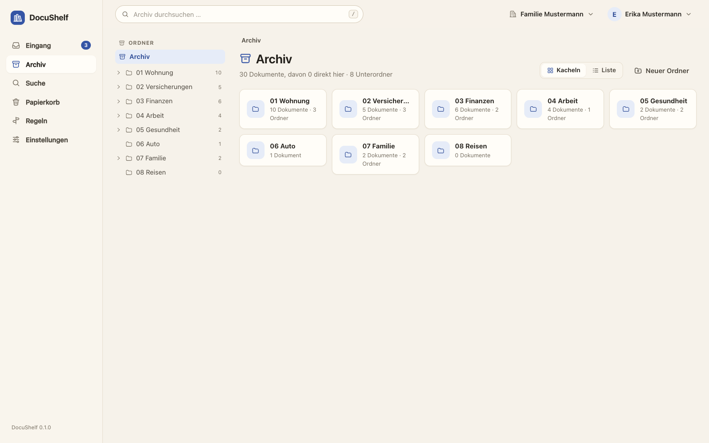 | 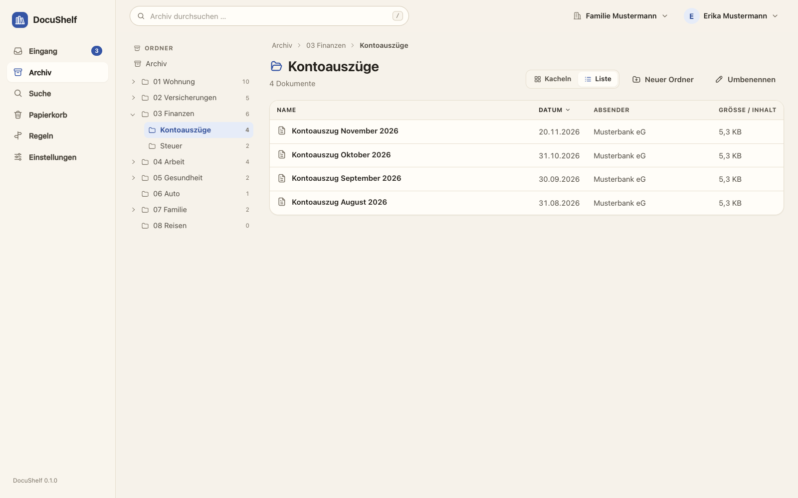 |
| Archive: the folder tree on disk, as tiles | The same archive as a list, newest first |
| 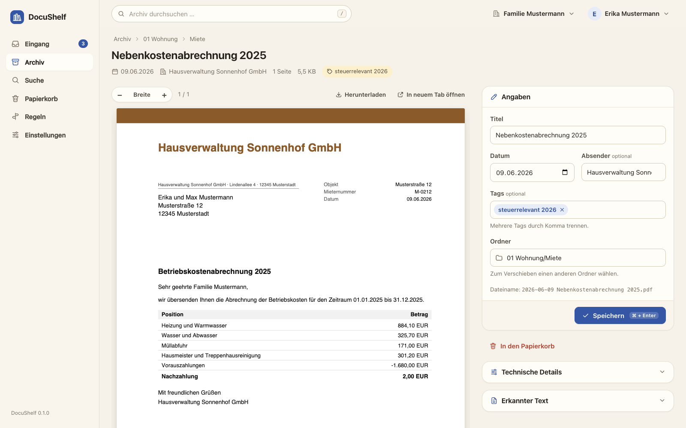 | 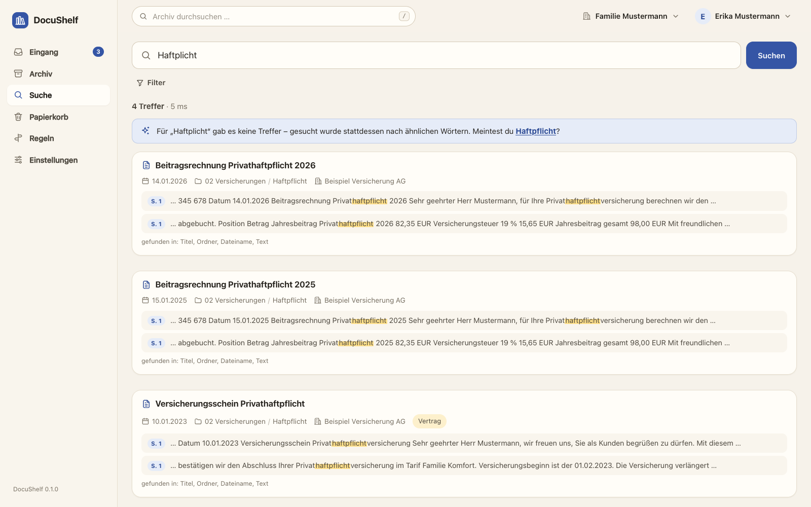 |
| Document: preview, title, date, sender, tags, folder | Full-text search with typo correction ("Meintest du …?") |
| 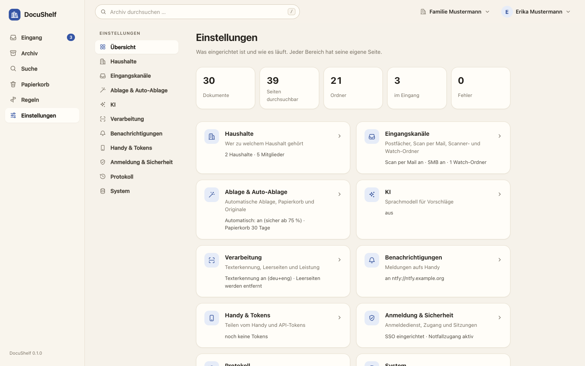 | 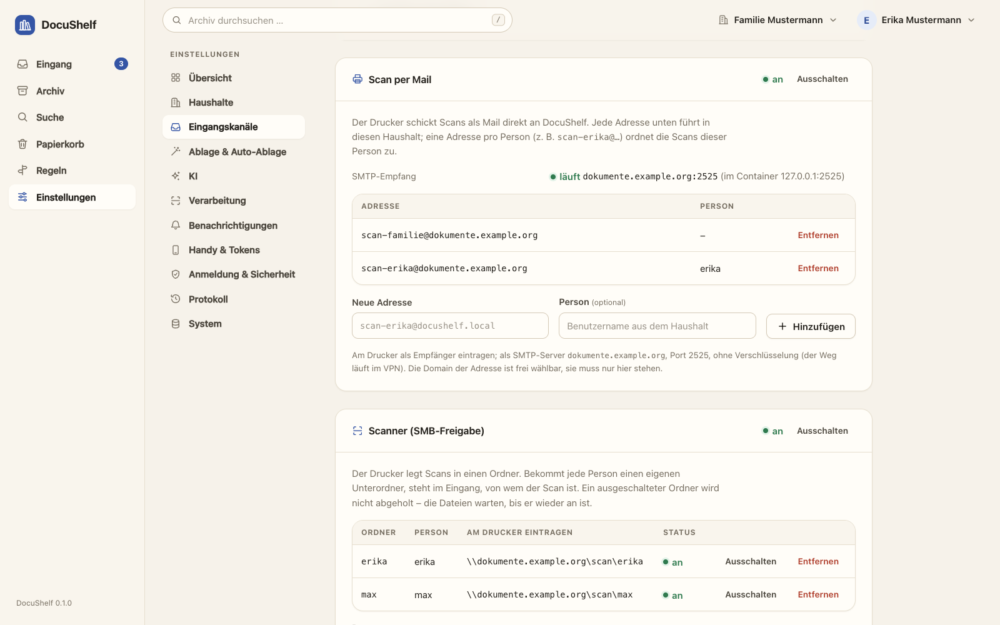 |
| Settings: an overview and one page per topic | Intake channels: mailboxes, scan-to-mail, scanner and watch folders |
| 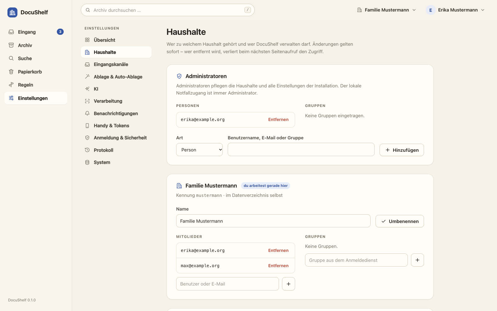 | 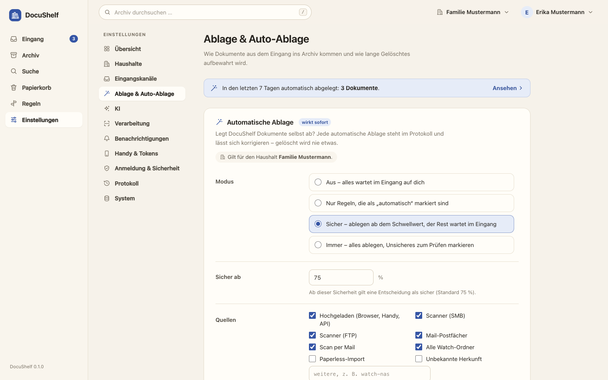 |
| Households, members and admins | Automatic filing: mode, threshold, sources |
| 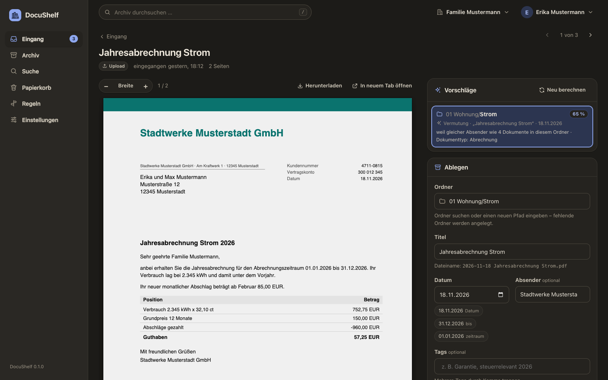 | 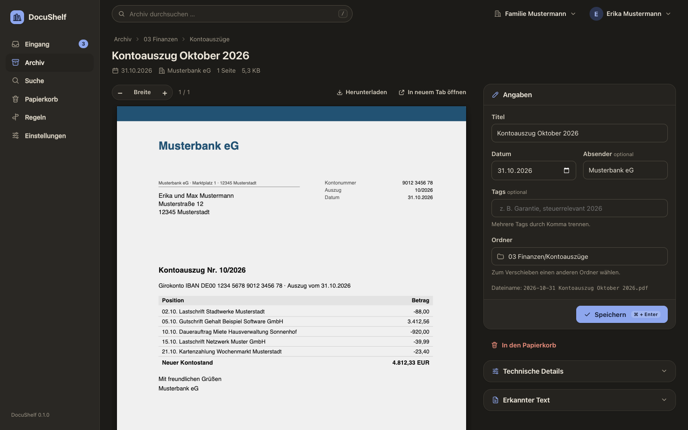 |
| Dark mode follows the system setting | Dark mode in the document view |

<p>
  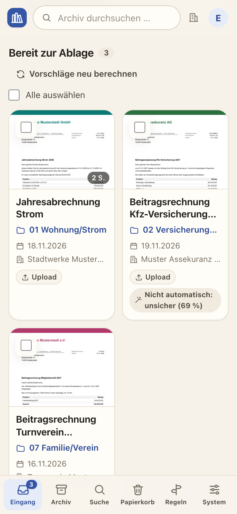
  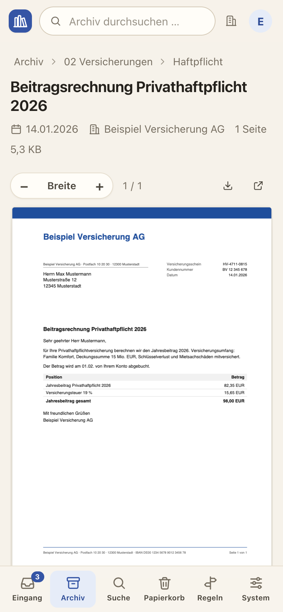
</p>

All pictures show made-up sample data (Musterstadt, Mustermann and friends).

## Principles

1. **Folders are the truth.** Every document is a file in a folder – no virtual folders in a
   database.
2. **The index is disposable.** The SQLite database is only a search cache and job queue;
   `docushelf rebuild` recreates it from the files at any time.
3. **Changes from outside are normal.** Move, rename or delete files in Finder or Explorer –
   DocuShelf updates its index.
4. **You stay in control.** Documents wait in the inbox with suggestions. Automatic filing is
   opt-in, logged, and every decision is visible and can be corrected.
5. **Data stays local by default.** A language model is optional; the default is a local Ollama.
   Document text is only sent to the endpoint you configure.
6. **Originals are never lost.** Failed documents go to an error area; nothing is overwritten.
7. **Readable without the app.** File names like `2026-03-12 Stromrechnung März.pdf`; metadata
   (title, date, sender, tags, document id) is stored as XMP inside the PDF. Digitally signed or
   password-protected PDFs stay untouched – their title and date live only in the file name.

More background: [docs/concept.md](docs/concept.md).

## Features

- **Inbox** with filing suggestions from rules, similarity to the existing archive and,
  optionally, a language model – each with a reason. Bulk filing with one click.
- **Automatic filing** (optional): what can be assigned confidently is filed with date and a
  meaningful title. Everything filed automatically appears in its own list to confirm or correct.
- **Intake channels:** web upload (drag & drop), REST API with tokens, watch folders, Samba share
  for scan-to-folder, FTP for scan-to-FTP, built-in SMTP receiver for scan-to-mail, IMAP polling
  for forwarded invoices.
- **Phone sharing:** installable web app with an Android share target; an iOS Shortcut generator
  (`contrib/ios`). See [docs/sharing.md](docs/sharing.md).
- **Processing:** images become PDFs, blank back pages are removed, OCR with OCRmyPDF (German and
  English, PDF/A), detection of date, sender, amounts, IBAN, customer and contract numbers,
  document type and duplicates.
- **Search** over title, folder and full text – finds partial words ("Neben" → "Nebenkosten­
  abrechnung"), tolerates typos and umlaut spellings, and shows the page of each hit.
- **Archive** browsing and editing in the browser (tiles or list); the same folders via SMB in
  Finder or Explorer. Trash with retention period, audit log.
- **Login** via OpenID Connect (e.g. Authentik, Keycloak), local emergency account.
- **Households** (optional): relatives use the same installation, each household with its own
  archive, inbox, rules, tokens and channels – nobody sees another household's documents. Access
  via OIDC groups per household; existing installations keep running without moving data.
- **Import from Paperless-ngx** with folder suggestions from document type, correspondent and
  storage path, or an explicit import plan; notes and custom fields are written into the PDF's
  XMP metadata.

## Quick start with Docker Compose

```sh
git clone https://github.com/xNycrofox/docushelf.git
cd docushelf/deploy
cp .env.example .env        # adjust DOCUSHELF_BASE_URL, login etc.
docker compose build
docker compose run --rm docushelf docushelf hash-password --env
#   → copy the printed line DOCUSHELF_ADMIN_PASSWORD_HASH='…' into .env
docker compose up -d
docker compose exec docushelf docushelf status
```

DocuShelf is then available at <http://127.0.0.1:8000> (for a first test without HTTPS set
`DOCUSHELF_BASE_URL=http://localhost:8000`). Data lives in `deploy/data/` or wherever
`DOCUSHELF_DATA_PATH` points.

The scan channel ports listen only on `127.0.0.1` unless configured otherwise. To let a printer
reach them, set the server's private address: `DOCUSHELF_PRIVATE_IP` for SMB and FTP,
`DOCUSHELF_SMTP_BIND` for the SMTP receiver. Also recommended: `DOCUSHELF_OWNER_NAMES` with the
names of the household members, so that your own name in the address field is not taken for the
sender.

For production with reverse proxy, OIDC, scan channels, backups, language model, automatic filing,
households and the network path from printer to server see **[DEPLOY.md](DEPLOY.md)** (German).

## Configuration

Admins change almost everything in the browser under **Einstellungen** – one page per topic
(households, intake channels, automatic filing, language model, processing, notifications,
phone and tokens, login and security, audit log, system). The same values can be set through
`DOCUSHELF_*` environment variables; the complete, commented list is in
[`deploy/.env.example`](deploy/.env.example).

- Environment variables win. A value set there is shown in the browser but locked
  ("festgelegt über Umgebungsvariable …").
- What is changed in the browser is written to `<data>/config/settings.yaml` (validated with the
  start-up loader, previous version kept as `settings.yaml.bak`); values of a single household go
  to its entry in `households.yaml`, channels to the household's `channels.yaml`.
- Secrets never go into these files and are never shown again: they live in
  `<data>/config/secrets/` (mode 600). From the environment they can be passed as files:
  `DOCUSHELF_OIDC_CLIENT_SECRET_FILE=/run/secrets/…`.
- Automatic filing, notifications, owner names, retention periods and the channels apply at once;
  everything else shows "Neustart nötig" with a button that restarts the server (the container's
  `restart: unless-stopped` brings it back).
- Readable files in `<data>/config/`: `rules.yaml` (filing rules, editable in the UI),
  `tokens.yaml` (API tokens, hashes only), `households.yaml` (optional),
  `paperless-import.yaml` (folder mapping for the import).

**Language model** (optional, `DOCUSHELF_LLM_*`): Ollama (default), any server with an
OpenAI-compatible API (`DOCUSHELF_LLM_PROVIDER=openai`: llama.cpp server, vLLM, LocalAI,
LM Studio) or the Anthropic API (`DOCUSHELF_LLM_PROVIDER=anthropic`). **The text of every
document is sent to the configured endpoint.** With a local Ollama nothing leaves your network.

The data directory:

```
data/
├── archiv/        the truth: your folder tree (can be a separate mount)
├── eingang/       quellen/<channel>/, arbeit/, bereit/, fehler/, erledigt/
├── papierkorb/    deleted documents (30 days)
├── config/        rules, tokens, settings, households
├── protokoll/     audit log (JSON Lines per month), including every automatic filing
├── index/         SQLite search index – may be deleted
└── haushalte/<id>/  further households, each with the same layout (optional)
```

## Automatic filing

By default every document waits in the inbox. With `DOCUSHELF_AUTO_FILE` DocuShelf files on its own:

| Mode | What is filed automatically |
|---|---|
| `off` (default) | nothing |
| `rules` | only documents matching a rule with `auto: true` |
| `confident` | additionally everything at or above the threshold (`DOCUSHELF_AUTO_FILE_THRESHOLD`, default 75 %) |
| `always` | everything; decisions below the threshold are marked for review |

Confidence comes from the suggestions: rules and the Paperless import count fully, similar
documents in the same folder almost fully, the language model a bit less – and agreement raises
it. Possible duplicates, manually edited documents and sources outside
`DOCUSHELF_AUTO_FILE_SOURCES` are never filed automatically. Every automatic filing is listed under
**Eingang → Automatisch abgelegt** with its reasons and can be confirmed or corrected.

## Households

Without `config/households.yaml` DocuShelf serves one household. With it, several families share
one installation:

```yaml
households:
  - id: familie-a
    name: "Familie A"
    path: "."                 # existing data stays where it is
    groups: [familie-a]       # OIDC groups with access
  - id: eltern
    name: "Eltern"
    groups: [docushelf-eltern]
```

Each household has its own archive, inbox, rules, API tokens, SMTP address, IMAP mailbox and
SMB/FTP drop folders. Users with access to several households get a switcher in the header.
Example: [`deploy/households.example.yaml`](deploy/households.example.yaml).

## Command line

Inside the container: `docker compose exec docushelf docushelf <command>`; help: `docushelf --help`.

| Command | Purpose |
|---|---|
| `serve` | start web UI, API and background services (container default) |
| `status` | overview: server, index, inbox, jobs (`--json`) |
| `rebuild` | discard the index and rebuild it from the files |
| `reconcile [--verify]` | reconcile the index with the archive once |
| `import-paperless EXPORT_DIR [--storage-path NAME]… [--plan FILE] [--mode inbox\|archive] [--dry-run]` | import a Paperless-ngx export |
| `hash-password [--stdin] [--env]` | create the password hash for the emergency account |
| `token create NAME [--user U]` · `token list` · `token revoke ID` | manage API tokens |
| `process ITEM_ID` | (re)process an inbox document now |
| `households [--json]` | list households with path, access and document count |
| `healthcheck [--url URL]` | check that the server answers (used by the Docker health check) |

With several households, data commands need `--household ID`.

## Development

Requires Python 3.12. For OCR locally also OCRmyPDF, Tesseract (with German language data) and
Ghostscript; without them OCR tests are skipped.

```sh
python3.12 -m venv .venv
.venv/bin/pip install -e '.[dev]'
.venv/bin/python -m pytest -q

DOCUSHELF_DATA_DIR=./dev-data \
DOCUSHELF_BASE_URL=http://localhost:8000 \
DOCUSHELF_ADMIN_PASSWORD=dev-admin-password \
.venv/bin/docushelf serve
```

All intake channels can be tested without a printer – the dev stack starts Samba, FTP and the
SMTP receiver with small clients that deliver a sample document
([`deploy/testdata/README.md`](deploy/testdata/README.md)):

```sh
docker compose -f deploy/compose.dev.yaml --profile smb --profile ftp --profile smtp up --build
```

See [CONTRIBUTING.md](CONTRIBUTING.md). Code comments are English; everything users see is German.

## Documentation

- [DEPLOY.md](DEPLOY.md) – operation (German): reverse proxy, OIDC, backup, scan channels,
  language model and automatic filing, network, households, migration from Paperless-ngx,
  updates, troubleshooting
- [ARCHITECTURE.md](ARCHITECTURE.md) – decisions and why
- [docs/internals.md](docs/internals.md) – module contracts for developers
- [docs/concept.md](docs/concept.md) – idea and principles
- [docs/sharing.md](docs/sharing.md) – sharing from phones

## License

[GNU Affero General Public License v3.0](LICENSE). Security issues: see [SECURITY.md](SECURITY.md).
